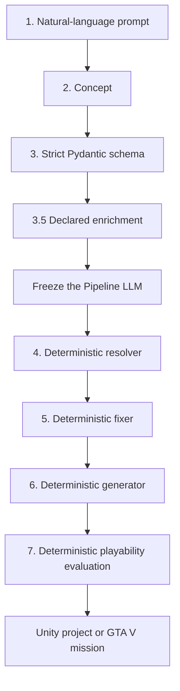

# GTA Mission LLM

[](https://github.com/1fasterone/GTA_mission_LLM/actions/workflows/ci.yml)
[](LICENSE)
[](https://www.python.org/)
[](https://unity.com/)

**Describe a game. Compile a reproducible Unity project or GTA V mission.**

GTA Mission LLM is a domain-agnostic procedural game-content compiler—a
game-o-matic. A swappable local LLM supplies the creative brief and structured
schema. Deterministic Python owns resolution, repair, code generation, and
playability checks.

Unity is the primary backend. GTA V mission generation is the project's
original secondary backend.

> This project is under active development. Generated projects should be
> reviewed and tested before distribution.

## Why this project is different

- **A compiler, not a chat chain.** The model stops after the schema and its
  declared enrichment phase.
- **Reproducible outputs.** Saved schemas can be rebuilt without calling the
  model again.
- **Real engine artifacts.** The Unity backend emits projects, scenes, scripts,
  prefabs, materials, packages, and deterministic wiring.
- **Composable systems.** More than 30 Unity micro-generators cover controllers,
  cameras, input, AI, UI, audio, VFX, objectives, rules, boards, and more.
- **Authored layouts win.** Scene Compiler layouts can supply exact models and
  transforms ahead of procedural placement.
- **Loud abstention.** Ambiguous or unsafe inputs are reported with a remedy
  instead of being silently guessed.

## Pipeline contract



The Pipeline LLM participates only in Steps 2, 3, and 3.5. Every enrichment is
persisted in the schema before the client is frozen. Any model call in Steps
4–7 raises an error. See [the LLM freeze-boundary contract](docs/LLM_FREEZE_BOUNDARY.md).

## What it can generate

### Unity

- Complete Unity 6 project folders from plain-English briefs
- Composed games with cross-system `GameWiring.cs`
- Standalone micro-generators for focused, portable features
- Image-guided composition with `unity-create --compose --viz`
- Exact authored model placement through the Scene Compiler
- Deterministic spatial layout, reachability, and playability evaluation
- Local asset-catalog, Kenney, frozen Sketchfab, and procedural-model paths
- Saved-schema replay through `unity-validate`

### GTA V

- ScriptHookVDotNet 3 mission scripts
- Peds, vehicles, props, objectives, blips, weather, and audio
- Standalone menu, HUD, spawner, wave, and save/load generators
- Saved-schema recompilation through `validate`

## Quick start

### Requirements

- Python 3.11+
- [LM Studio](https://lmstudio.ai/) or [Ollama](https://ollama.com/) for local
  model inference
- Unity 6000.x to open and verify generated Unity projects
- GTA V plus ScriptHookVDotNet 3 only when running generated GTA missions

### Install on Windows

```powershell
git clone https://github.com/1fasterone/GTA_mission_LLM.git
cd GTA_mission_LLM

py -3.11 -m venv .venv
.\.venv\Scripts\Activate.ps1
python -m pip install --upgrade pip
python -m pip install -r requirements.txt -r requirements.lock
Copy-Item config.example.yaml config.yaml
```

Set the model name in `config.yaml`, then start the local model server. The
default expects LM Studio at `http://localhost:1234/v1`.

### Generate a composed Unity project

```powershell
python main.py unity-create --compose "a top-down survival game with waves of enemies"
```

Output is written under `output/unity/<ProjectName>/`.

Add a visual reference:

```powershell
python main.py unity-create --compose --viz .\reference.png "a bright sci-fi arena shooter"
```

Replay a saved schema without the LLM:

```powershell
python main.py unity-validate .\output\unity\MyGame\MyGame.schema.json --compose
```

### Generate a GTA V mission

```powershell
python main.py generate "infiltrate the docks at night and steal a shipment"
```

Replay its saved schema:

```powershell
python main.py validate .\output\DocksInfiltration.schema.json
```

### Use the local web UI

```powershell
python main.py serve
```

Open `http://127.0.0.1:8000`.

For a shorter guided setup, see [QUICKSTART.md](QUICKSTART.md). List every CLI
command with `python main.py --help` and every Unity micro-generator with
`python main.py unity-tools list`.

## Configuration

Copy `config.example.yaml` to `config.yaml`. The main choices are:

| Setting | Purpose |
|---|---|
| `lm_studio.backend` | Selects `lm_studio`, `ollama`, or another configured backend |
| `lm_studio.model` | Model identifier exposed by the selected server |
| `basic_mode` | Skips RAG and uses deterministic local lookups |
| `rag.fallback_to_local` | Uses bundled lookups when the local index misses |
| `unity_pipeline.unity_output_dir` | Destination for generated Unity projects |
| `playability.gate` | Controls deterministic Step 7 acceptance |

Do not commit API keys. Cloud-backend credentials belong in environment
variables or an ignored `.env` file.

## Reproducibility and authority

The schema is the canonical input to the deterministic half of the compiler.
Generated Unity files are outputs: change the compiler, schema contracts, or
templates, then regenerate.

For image- and scene-driven work, preserve the associated evidence, manifests,
asset hashes, and authored scene files. The author-provided model placement
outranks generated placement only through the documented Scene Compiler path.

## Repository map

| Path | Responsibility |
|---|---|
| `main.py`, `cli/` | Typer entry point and command implementations |
| `src/atoms/` | Deterministic primitive action definitions and registry |
| `src/micro/` | Composable Unity feature generators |
| `src/unity_pipeline.py` | Unity pipeline orchestration |
| `src/pipeline.py` | GTA V pipeline orchestration |
| `src/unity_schema.py` | Unity intermediate representation |
| `src/mission_schema.py` | GTA V intermediate representation |
| `templates/` | Deterministic backend code-generation templates |
| `lookups/` | Local deterministic catalogs and mappings |
| `rag/` | Optional local retrieval corpus and index tooling |
| `tests/` | Unit, contract, regression, and acceptance tests |
| `docs/` | Architecture, contracts, and workflow references |

## Development checks

```powershell
python -m pip install -r requirements.txt pytest mypy ruff
ruff check src main.py cli rag
mypy src main.py cli rag
pytest -q tests/test_frozen_step35_acceptance.py
pytest
```

Pull requests run Ruff, mypy, the full pytest suite, the frozen Step 3.5
acceptance test, and Blender-render tests.

## Key documentation

- [Quick start](QUICKSTART.md)
- [LLM freeze boundary](docs/LLM_FREEZE_BOUNDARY.md)
- [Schema extensions](docs/SCHEMA_EXTENSIONS.md)
- [Scene Compiler](docs/SCENE_COMPILER.md)
- [Layout archetypes](docs/LAYOUT_ARCHETYPES.md)
- [Unity micro-generators](docs/micro-generators.md)
- [Playable-game contract](docs/PLAYABLE_GAME_GAP.md)
- [Testing and runtime acceptance](docs/TESTING.md)

## Contributing and security

Contributions are welcome. Read [CONTRIBUTING.md](CONTRIBUTING.md) before
opening a pull request. Please report security problems privately according to
[SECURITY.md](SECURITY.md), not in a public issue.

## License

Copyright © 2026 1fasterone. Original project code is licensed under the
[GNU Affero General Public License v3.0 or later](LICENSE).

Bundled third-party models, textures, fonts, sounds, and vendor code retain
their own licenses. See [THIRD_PARTY_NOTICES.md](THIRD_PARTY_NOTICES.md) and
the license files distributed beside those assets.
