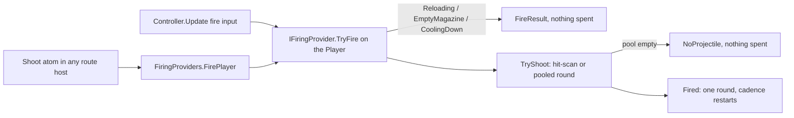

# Atom/backend support, mechanic ownership and typed bindings (S0-S5)

The S0 support audit was integrated with main `c83646b240fb4222ac112777fee1761d656acca1`
after the #282 squash merge. S2 later made selected rendered C# source authoritative
for consumer-visible APIs. S3 adds structural mechanic connection and ownership
closure in [MECHANIC_OWNERSHIP.md](MECHANIC_OWNERSHIP.md). No gameplay
implementation, public vocabulary, or runtime owner is changed by S3.

## Branch readiness

Integration status checked November 4, 2026:

| PR | Work | Audit dependency | Disposition |
| --- | --- | --- | --- |
| #279 | Persist composed controller/micro selection | Required for later replay integration, not S0 inventory | Leave separate draft open |
| #280 | Complete Step 3 brief and beta startup | Independent of dispatch/ownership inventory | Leave separate draft open |
| #281 | Phase 0 authority and compilation infrastructure | Independent of S0; overlaps #282 | Leave separate draft open |
| #282 | Intent authority, registry pilot and infrastructure | Integrated prerequisite for current main | Merged as `c83646b`; shared-policy generation preserved |

PR #282 is merged. Its validated tree passed the real Unity Editor compile gate
(run `41793840269`); earlier missing-license reports are historical. Unity
credentials are configured. This S0 integration still requires its own Python,
generated-C# and Unity CI results; the earlier run is not evidence for this head.
The generated shared policy remains owned by
`docs/policies/shared-agent-guidance.md` and `tools/sync_agent_guidance.py`.
This slice does not change review requirements, protection, secrets or gates.

## Authority and meaning

Run from the repository root:

```sh
python -m src.atoms.support_audit --check
python -m src.atoms.ownership_audit --check
```

The command inspects actual atom definitions, aliases, backend dispatch tables,
all registered micro variants, and the standalone/composed call paths. It emits
no pipeline schema and invokes no LLM. The checked-in machine-readable result is
[atom_backend_inventory.json](atom_backend_inventory.json). CI runs the command
and the mutation tests in `tests/test_atom_support_audit.py`.

| Classification | Meaning | What it does not establish |
| --- | --- | --- |
| executable | Registered backend lowerer emits deterministic statements for the emission fixture | C# binding, correct host, physics timing, or runtime behavior |
| descriptive | Definition advertises this backend but no lowerer exists | Execution through a different template is not execution of this atom |
| unsupported | Backend excluded by AtomDef.engines | No inference from another backend's implementation |
| internal | Dispatch-only helper without a public AtomDef | Not new public vocabulary or proof of schema reachability |

`runtime_acceptance` is **unverified** throughout. This is a structural and
emission audit, not semantic compilation or Unity/GTA runtime acceptance. The
twelve bound emission cases under `tests/fixtures/` are engineer-authored synthetic
fixtures for guarded seams. All other public lowerers use AtomDef defaults.
They are never presented as real Pipeline LLM output or actual scene bindings.

## Observed baseline

| Backend | Executable lowerers | Descriptive gaps | Unsupported definitions | Dispatch-only helpers |
| --- | ---: | ---: | ---: | ---: |
| Unity | 72 | 24 | 0 | 0 |
| GTA5 | 26 | 0 | 70 | 0 |

The Unity gaps are AimDownSights, Ascend, Block, Boost, Brake, CycleWeapon,
Dash, Descend, Dodge, Grab, Interact, MeleeAttack, Nitro, OpenInventory, OpenMap,
Pause, Pitch, PrimaryAttack, Reload, RollPlane, SecondaryAttack, Throttle,
ThrowGrenade and UseItem, all baselined for S6. `fire` remains an alias of
canonical `Shoot`, which R3 lowered (see "Shared firing provider" below).

## R1 vocabulary decisions (S0 follow-up closed)

R1 closed all 16 `S0-followup-*` baseline entries. No entry was closed by
re-labelling: each one either got a single owner, a registration backed by a
real lowerer, or retirement.

**Identity policy: one owner per token.** A token is an atom's canonical name or
alias, compared case-insensitively. `src/atoms/__init__.py` builds the lookup
index with `_build_alias_index`, which raises at import when two atoms claim one
token. First-registered-wins, which made a lookup depend on module order, is
gone. The audit still reports any collision as an unreviewed identity conflict.

| Token | Owner | Dropped from | Why | Lookup change |
| --- | --- | --- | --- | --- |
| pause | Pause | Wait | Canonical name outranks an alias; matches the controller `pause` ability and the `Pause` input action | `pause` was Wait, now Pause |
| roll_evade | Dodge | Dash | Evade family (`dodge`, `evade`, `sidestep`); Dash keeps `dash`, `quick_step` | was Dash, now Dodge |
| thrust | Throttle | ApplyForce | The controller's Thrust section is throttle-driven; ApplyForce keeps `push`, `add_force` | none |
| kick | SecondaryAttack | ApplyImpulse | The fighting variant defines kick as secondary_attack; ApplyImpulse keeps `impulse`, `knockback` | none |
| look_at | CameraLookAt | LookAt (dialog) | Already the camera's; the NPC head-look keeps `npc_look_at`, `head_look` | none |

Unity code generation dispatches on the raw atom name (`_SNIPPETS.get`), never
through aliases, so no generated C# changes. Alias lookups feed
`atom_snippet()`, the mechanics playtest's category label and the CLI only.

**Dispatch-only helpers: registered.** SayLine, PlayDialogAudio, Gesture, LookAt
and EndDialog already had `AtomDef`s (`src/atoms/dialog.py`) and real Unity
lowerers, but were never added to `ALL_ATOMS`. They are now registered as
`engines=["unity"]` in a new `dialog` category. `dialog` is not in
`_SEQUENCE_ATOM_CATEGORIES`, so the Step 3 prompt vocabulary is unchanged; their
callers remain the npc_dialog micro and its companion sequence.
WireTriggerToEscortObjective joins its registered `wiring` siblings with the
same parameters `MicroComposer` already passes. No new token was invented: each
name existed with a lowerer before R1.

**Unregistered capability names: retired.** InitDialogSystem, BarkOnSight,
EnableNavMesh, SetAIBehavior, EnableParticles and EnablePostProcessing were
built by `capability_resolver` and folded into `schema.atoms`. None was
registered or had a lowerer, so each reached GameSequencer as a `// TODO`
comment that read like scene setup but did nothing. Registering them would have
invented public vocabulary with no executable meaning, so they were retired.
Nothing else consumes the `dialog`, `ai` and `vfx` capabilities either: micro
selection (`unity_compose.subsystems_for`) reads `capabilities.controller` alone,
so declaring them adds no dialogue, statemachine or trigger micro, and
`capabilities_to_active_microgens` is descriptive only. Wiring them into
selection would change generated projects and is left to a later slice. Each
declared one, with the params no lowerer consumes (`dialog.system`,
`dialog.bark_on_sight`, `ai.pathfinding`, `ai.behavior`, `ai.detection_range`,
`vfx.particles`, `vfx.post_processing`), is named in a Step 5 fix message rather
than emitted as placeholders. A saved schema that already holds one of these names still lowers
to the same `// TODO` comment on replay; schemas are never rewritten.

## Typed atom bindings (R2, S4)

`src/atom_bindings.py` derives, for every atom-carrying schema field, the route
that starts it, and persists the record in `schema.meta["atom_bindings"]`
(`version: 1`, `backend: "unity"`):

| Route source | Host class | Host | Phase | Trigger |
| --- | --- | --- | --- | --- |
| `atoms` | `GameSequencer` | `_GameSequencer`, every gameplay scene | `start_coroutine_once` | `scene_load` |
| `entities[<name>].atoms` | `<Name>Behavior` | `EntitySpawner.AddComponent`, scenes hosting the group | `start_coroutine_loop` unless the sequence despawns | `entity_spawn` |
| `scripts[<name>].atoms` | the custom script | its `attach_to` scene object | `start_coroutine_once` | `scene_load` |

Each atom in a route carries its provider: the Unity lowerer it reaches
(`src/atoms/backends/unity.py:_wait`), or a status saying why there is none.

- **Per-build reference validation.** Atom names in schema data are dynamic
  references the static audit cannot see. Unity dispatches on the raw name, so
  an alias (`delay`), an unregistered name, a descriptive atom with no lowerer
  or an atom excluded from Unity lowers to a `// TODO` comment. Each one is
  named as a warning (`alias`, `unregistered`, `descriptive`, `unsupported`);
  nothing is rewritten.
- **Host-relative atoms.** Each lowered atom records the host members its
  emitted C# depends on (`host_members`), read from the exact snippet generation
  emits: the host's `transform`, a bare `GetComponent*` it does not add itself,
  or a bare `SendMessage`. `_GameSequencer` carries only a Transform and the
  sequencer, so a host-relative atom there (`Teleport`, `MoveTo`, `SetModel`)
  provably changes no gameplay object and is warned, naming the remedy (author
  it in the target entity's atoms). Entity and custom-script hosts can carry
  what such an atom needs, so they record the evidence without a warning.
- **One source of truth.** `UnityProjectGenerator.generate` derives the record
  after entity-behavior reconciliation, script preparation and model resolution,
  then places hosts from it. The scene's `_GameSequencer` and the emitted
  `GameSequencer.cs` cannot disagree with what is recorded. A route with no host
  scene (a menu-only build) emits no sequencer and records why.
- **Entity behavior.** An entity's atoms render only into `<Name>Behavior`, so
  reconciliation sets `entity.behavior` to that class. A blank or foreign name
  used to leave the class emitted but never added at spawn.
- **Versioned replay.** Pipeline, `unity-validate` and `unity_eval.replay` all go
  through `generate()`. A saved record that matches is confirmed. One that drifts
  is reported route by route. One this compiler cannot read (another version, an
  unknown key) is announced. The schema's atom lists are canonical, so the record
  is re-stamped in each case and never trusted silently. Replaying a saved schema
  twice reproduces an equal record both times (`tests/test_atom_bindings.py`).

Scope limit: the record covers the three schema-data routes above. Wiring atoms
are compiler-selected, not schema data, and stay in `GameWiring`. No gameplay
moves onto a new phase here; S5/S6 add their own bindings before migrating.

## Shared firing provider (R3, S5)

`Shoot` and the controller's fire input now reach one gate, so ammunition,
fire-rate cadence and reload state have exactly one owner.



| Piece | Where | What it guarantees |
| --- | --- | --- |
| Contract | `templates/unity/micro/controller/FiringProvider.cs.j2`, names in `src/firing_provider.py` | `FireResult`, `IFiringProvider`, `FiringProviders.FirePlayer()` (resolves the provider on the object tagged Player) |
| Implementer | `Controller.cs.j2` with the `shoot` ability (`provides_firing`) | `TryFire()` refuses in a fixed order (Reloading, EmptyMagazine, CoolingDown) and is the only caller of `TryShoot()`; only `TryShoot()` spends ammo or restarts cadence, and only after a round launched |
| Fire input | `Update`: `if (fireDown) TryFire();` | The input no longer carries its own copy of the gate |
| Lowerer | `src/atoms/backends/unity.py:_shoot` | Emits only `FiringProviders.FirePlayer()`; `NoProvider` is a logged error with its remedy, any other refusal a logged warning naming its `FireResult` |
| Typed binding | `AtomBinding.runtime_provider` (`src/atom_bindings.py`) | Records `{contract, host, implementer}` from the lowered C#. The implementer must sit where the resolver looks: only a shooting controller on the `player` target (`firing_provider.HOST_TARGET`, the units `scene.unity.j2` puts on the Player) counts. With no implementer the build warns. When no composed micro emitted the contract either (`firing_contract_emitted`), `generate()` emits it alone in `Assets/Scripts`, so the atom compiles and refuses at runtime without a duplicate type |

Decisions:

- **Shoot takes no parameters.** Its former `fire_rate`, `magazine` and
  `shoot_range` duplicated the weapon loadout (`ControllerSchema.weapons`).
  With one provider they could only be ignored or become a second owner, so
  they were retired. A saved schema that still passes them is named per build
  (`AtomBinding.ignored_args`: the atom "declares no parameters, so arg(s) …
  change nothing"); its args are never rewritten.
- **The first shot is never cooling down.** `_lastFireTime` starts at negative
  infinity. It used to start at 0, which refused every shot for one `fire_rate`
  after scene load, including a `GameSequencer` Shoot at its 0.1 s start delay.
- **One emitter at a time.** The controller micro writes `FiringProvider.cs`
  beside its implementer. `generate()` writes its contract-only copy only when
  a lowered atom needs the contract and `contract_implementers_for` finds no
  implementer. Both read `provides_firing`, so a project never carries two
  copies (CS0101).
- **Record format.** `runtime_provider` and `ignored_args` are additive
  optional fields of `atom-bindings` v1. An R2 record without them replays
  identically; one that lowered `Shoot` as descriptive drifts once and is
  re-stamped.

Evidence: `tests/test_firing_provider.py` (template gate, lowerer, binding,
both generator paths, replay, and a Roslyn compile of the emitted controller,
contract and lowered `Shoot` against the real Unity reference assemblies), the
ownership audit's `shared_firing_provider` route, and the Play Mode acceptance
(`tools/run_firing_provider_acceptance.ps1`, tests in
`tests/unity_firing_provider/`). The Play Mode test drives the provider
directly and through the generated `GameSequencer`. The fire input's call into
the gate is proven structurally: batchmode cannot drive hardware input.

Scope limit: the controller and projectile templates stay the runtime owners
(`protected_template_owners`). R3 shares their gate; it does not migrate them
(S6). Only the Player fires through the provider: entity `Shoot` atoms fire the
Player's weapon, because no other composed class implements the contract.

## Ownership and reachability

- Schema-level atoms lower into `GameSequencer.Start`, hosted by every gameplay
  scene's `_GameSequencer` object since R2 (`connected_and_owned`). The host is
  scene-local on purpose: `GameManager` is `DontDestroyOnLoad` and destroys a
  later scene's duplicate, which would take a sequencer on it down too.
- The representative behavior-map entity route resolves a behavior class, renders
  `EntityBehavior`, attaches through `EntitySpawner`, and loops its coroutine in
  place, yielding at least one frame per pass, unless the sequence ends in `Despawn`.
  S3 does not generalize that proof to a raw `EntitySpec.atoms` value whose behavior
  class was not deterministically selected. Custom-script atoms remain a separate
  generator path and do not replace micro gameplay.
- Unity wiring atoms are explicitly called by MicroComposer to emit subscriptions,
  Update bridges and event handlers into GameWiring. These are the existing
  executable composition seams, not a universal lifecycle binding system.
- Unity standalone `<Kind>DefaultBehavior` companions are retired (R2). No scene
  ever attached one, and the controller companion's looping Look/Move/Sprint/Jump
  would have fought the template-owned controller. `UnityMicroPipeline._after_write`
  makes no call, and the ownership audit proves that for every Unity micro.
  `MICROGEN_ATOM_MAP` remains descriptive data.
- GTA5 standalone companions run from a Script.Tick guard, optionally entering
  a yielding loop. This does not prove inclusion in the minigame skeleton.
- The inventory enumerates every registered Unity/GTA micro and all its variants.
  Controller (including pointer/multi_mode), board, rules and projectile gameplay
  remain template-owned. ModelPipeline is an asset pipeline, not a gameplay
  provider. R3 adds no owner: `Shoot` reaches the controller's own firing gate
  (`shared_firing_provider`), and movement, physics and avatar ownership are
  unchanged.

## Migration queue and compatibility

[The reviewed debt baseline](../lookups/atoms/support_baseline.json) gives every
missing lowerer, dispatch-only helper, unregistered reference and identity collision a reason and next
slice. It is a ratchet, not a second public API or implementation table.

| Follow-up | Required change before claiming completion |
| --- | --- |
| S0 vocabulary/alias review | Done in R1: one owner per token, dialog/escort helpers registered, six capability placeholders retired |
| S1–S2 | Extract selected rendered C# APIs with Roslyn and remove copied API tables |
| S3 | Structural representative closure implemented; preserve explicit unattached/missing-provider abstentions in `mechanic_ownership_inventory.json` |
| S4 | Done in R2: typed route bindings in `meta.atom_bindings` with versioned replay; GameSequencer attached; Unity companions retired; dynamic atom references checked per build |
| S5 | Done in R3: `Shoot` lowered through `IFiringProvider.TryFire`, the gate the fire input calls; ammo, cooldown, reload, pool and no-provider refusals tested |
| S6 | Migrate controller behaviors one at a time, with per-variant advancing tests |
| S7–S8 | Migrate legal board operations and rules progression through one owner |

The audit does not alter schemas, atom names, aliases, emitted C#, GUIDs or scene
identities. Reverting this slice removes the audit and its documentation/CI check;
there is no second active runtime implementation to disable.

## Updating the inventory

```sh
python -m src.atoms.support_audit --write
python -m src.atoms.support_audit --check
python -m pytest -q tests/test_atom_support_audit.py
python -m src.atoms.ownership_audit --write
python -m src.atoms.ownership_audit --check
python -m pytest -q tests/test_mechanic_ownership_audit.py
```

`--write` cannot approve new missing lowerers or identity conflicts. New debt,
unsupported backend handlers, duplicate definitions/aliases/dispatch keys,
comment-only or nondeterministic public lowerers, changed policy blocks and
unsupported runtime ownership claims fail. Closing a known gap requires removing
its stale baseline entry. Review the resulting inventory diff in the same PR.

Compilation and advancing runtime tests remain mandatory for later runtime
migrations. Missing tooling and skipped runtime tests remain **unverified**.
