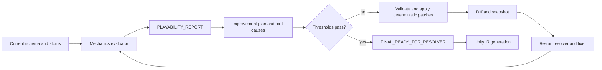

# Mechanics Playtest Improvement Loop

This document extends the mechanics-playtest slices with the improvement loop
described in the attached `PLAYTEST IMPROVEMENT SYSTEM` brief.

The attachment is treated as a design requirement, not as repository
instructions. The repository contract still wins: Steps 4–7 are deterministic,
the pipeline LLM stops after schema fill, no Unity code is generated by this
system, and unknown atoms or schema fields cause an explicit abstention.

## Current state and gap

The first three slices are already implemented as stacked PRs:

| Slice | Scope | Status | What it proves |
|---|---|---|---|
| 1 | Deterministic evaluator | PR #201 | Produces the exact `PLAYABILITY_REPORT` sections from normalized inputs. |
| 2 | Unity adapter and composition dry-run | PR #202 | Maps `UnitySchema` plus the real composer seam decisions into the evaluator without writing Unity files. |
| 3 | CLI/config | PR #203 | Runs one report, exports JSON, supports `--compose`, and gates on `PASS`/`FAIL`. |

Slices 1–3 are sufficient for a one-shot pre-IR judgment. They are not yet
sufficient for the attached loop: they do not produce patch-ready schema/atom
updates, previous-vs-updated diffs, resolver patches, or bounded CI retries.
Slices 1 and 2 do not need to be rewritten. Slice 3 remains the report/gate
surface, but the improvement loop needs the contract extensions in Slice 4
before it can safely mutate anything.

## Non-negotiable contract

The improvement loop consumes:

- `SCHEMAS` — the current validated schema snapshot.
- `ATOM_IR` — the current registered atom invocations.
- `WORLD_ATOMS` and `CHARACTER_ATOMS` — current atom ownership partitions.
- `RESOLVER_OUTPUT` — deterministic resolver/composer output.
- `PLAYABILITY_REPORT` — the report from the evaluator.
- `PREVIOUS_SCHEMAS` and `PREVIOUS_ATOM_IR` — immutable snapshots for diffing.

It produces one deterministic `PLAYTEST_IMPROVEMENT_PLAN` containing the
attachment's required blocks:

```text
FAIL_SUMMARY
ROOT_CAUSE_ANALYSIS
REQUIRED_SCHEMA_UPDATES
REQUIRED_ATOM_UPDATES
ATOM_MUTATION_RULES
SCHEMA_DIFF
ATOM_DIFF
RESOLVER_PATCH_GENERATOR
THRESHOLD_GATING_LOGIC
CI_LOOP_INSTRUCTIONS
```

The plan's update blocks must carry both the patch operations and their
candidate post-patch snapshots. The required machine-readable payload is:

```text
REQUIRED_SCHEMA_UPDATES:
  SCHEMA_PATCH
  UPDATED_SCHEMAS
REQUIRED_ATOM_UPDATES:
  ATOM_PATCH
  UPDATED_ATOM_IR
ATOM_MUTATION_RULES:
  rules
  MUTATED_ATOM_IR
RESOLVER_PATCH_GENERATOR:
  RESOLVER_PATCH
```

When a safe candidate cannot be produced, the corresponding updated block is
`status: abstain` with the exact reason and triggering report path. It must not
be omitted or filled with a guessed snapshot. The read-only generator may
construct candidates in memory; only the patch engine and CI loop may persist
or replace snapshots.

The system may propose or apply only changes represented by reviewed,
schema-aware patch operations. It must not:

- call an LLM;
- invent an atom name or silently register one;
- invent a normal schema field outside the schema's `extensions` namespace;
- replace a missing fact with a guessed target, reward, control, or feedback;
- emit C#, Unity IR, Unity assets, or Unity scenes;
- mutate the caller's current or previous snapshot in place;
- apply a patch whose precondition does not match the snapshot it was created
  against.

If a correction needs a new real schema field, the plan emits a blocked
`schema_migration_required` finding. It does not smuggle that field into the
schema. An `extensions` update is allowed only when its field name/type/default
passes the existing extension safety rules.

## Loop shape



The loop runs between deterministic schema resolution/fixing and Unity IR
generation. Every retry re-runs the resolver/fixer after a patch; it never
edits generated Unity output to hide a mechanics failure.

## Slice 3 contract extension

The existing `unity-mechanics-playtest` command remains a read-only evaluator.
Before the loop slices are implemented, its config surface must be extended
with a single deterministic section:

```yaml
mechanics_playtest:
  enabled: true
  gate: false
  max_seconds: 300
  max_iterations: 3
  report_dir: output/mechanics_playtest
  require_graded_scores: true
  auto_apply: false
  thresholds:
    fun_min: 7
    friction_max: 4
    pacing_min: 6
    readability_min: 7
    systemic_coherence_min: 7
```

The current `gate` and `max_seconds` settings remain backward-compatible. The
new settings are consumed by the loop, not by the one-shot evaluator unless a
caller explicitly asks for the loop.

The future improvement command must accept explicit snapshot paths rather than
silently reading mutable working files:

```text
unity-playtest-improve
  --schema CURRENT.schema.json
  --report iteration-000/report.json
  --previous-schema iteration-000/schema.json
  --previous-atoms iteration-000/atoms.json
  --resolver-output iteration-000/resolver.json
```

All paths are inputs to a deterministic run and are recorded in the plan with
content hashes.

## Slice 4 — Improvement-plan generator (read-only)

Build a `PLAYABILITY_REPORT` → `PLAYTEST_IMPROVEMENT_PLAN` converter. This
slice diagnoses and proposes patches but does not apply them.

### Required behavior

1. Preserve every report failure in `FAIL_SUMMARY`, including score failures,
   missing feedback/affordance, dead loops, reward failures, unresolved
   dependencies, and mission-flow failures.
2. For every entry, record the exact triggering report path, such as
   `PLAYABILITY_FIXES[0]`, `MISSION_FLOW_VALIDATION[1]`, or
   `FRICTION_SCORE.risks[0]`.
3. Resolve responsibility to an existing schema field, atom, resolver edge, or
   composer seam. If responsibility cannot be proven, emit an abstention rather
   than guessing.
4. Produce patch-ready update records with exact old values, deterministic new
   values, preconditions, severity, and source report path.
5. Apply the accepted records to in-memory copies and emit
   `UPDATED_SCHEMAS`, `UPDATED_ATOM_IR`, and `MUTATED_ATOM_IR`; never mutate
   the input files in this slice.
6. Emit `SCHEMA_DIFF` and `ATOM_DIFF` even when both are empty.
7. Emit a resolver patch proposal only for existing resolver capabilities or a
   separately registered deterministic rule.

### Plan record shape

Each proposed update has this minimum shape:

```json
{
  "id": "fix-0001",
  "kind": "schema | atom | resolver",
  "operation": "add | modify | remove | abstain",
  "target": "exact.path.or.atom.identity",
  "expected": "snapshot value or content hash",
  "replacement": "deterministic value",
  "severity": "low | medium | high | blocker",
  "trigger": "PLAYABILITY_REPORT.PLAYABILITY_FIXES[0]",
  "reason": "why this correction closes the finding"
}
```

### Acceptance tests

- A missing objective transition produces a mission-flow plan with the exact
  objective ID and no invented event source.
- An unknown atom produces a blocker and an abstention, never an atom addition.
- A missing reward consumer produces a reward-loop update only when an existing
  consumer/progression field is available.
- A plan generated twice from byte-identical inputs is byte-identical.
- A changed previous-snapshot hash makes the plan abstain instead of applying
  against the wrong baseline.

## Slice 5 — Deterministic schema/atom patch and diff engine

Implement the patch model and applier for the `REQUIRED_SCHEMA_UPDATES`,
`REQUIRED_ATOM_UPDATES`, `ATOM_MUTATION_RULES`, `SCHEMA_DIFF`, and `ATOM_DIFF`
blocks.

### Mutation rules

- Never remove an atom unless it contradicts a validated schema rule.
- Always add an atom explicitly required by an accepted schema update.
- Always update dependent atoms when an accepted schema field changes.
- Preserve atom order where order is gameplay-significant; otherwise sort by
  the existing deterministic identity rule.
- Reject duplicate atom identities, unknown atom types, missing targets, and
  failed expected-value preconditions.
- Never use a default value merely because a field is absent. Emit an
  abstention when the source data does not establish a safe value.

### Diff requirements

`SCHEMA_DIFF` and `ATOM_DIFF` must separately list added, removed, and modified
fields/atoms, plus added, removed, and modified rules/transitions. Each diff
entry carries the old value, new value, operation ID, and source report path.
Empty lists are valid and required; omission is not.

### Acceptance tests

- Patch application is idempotent.
- Reapplying a patch to the already-updated snapshot is rejected by its
  precondition rather than duplicating an atom or field.
- A patch generated against snapshot A cannot apply to snapshot B.
- The original snapshots remain unchanged.
- JSON serialization preserves ordering and produces the same diff on every run.

## Slice 6 — Resolver-patch generation and validation

Add a deterministic resolver patch ledger. The ledger is the only supported
way for the improvement loop to request a new resolver behavior.

Each resolver patch must identify:

- the existing resolver module/rule ID;
- the input schema/atom shape it accepts;
- the exact transition or dependency it adds/modifies;
- the deterministic precedence/order relative to existing rules;
- the validation test that proves it does not shadow or contradict another
  rule;
- the report failure it addresses.

Unknown resolver rule IDs are blockers. A plan may request a new rule only as a
reviewed registry entry with a test fixture; it must not generate executable
Python or C# source from free-form text.

### Acceptance tests

- Every updated atom has a registered resolver/backend path or produces a
  blocker before Unity IR.
- Two resolver patches with the same identity are rejected unless their
  content hashes match.
- A conflicting transition precedence is reported as a contradiction.
- Applying a resolver patch and re-running the resolver produces a stable
  `RESOLVER_OUTPUT` diff.

## Slice 7 — Threshold gate and bounded CI loop

Add the automatic retry controller. It consumes the plan and patch engine, not
Unity output.

### Required thresholds

```text
FUN_SCORE                 >= 7
FRICTION_SCORE            <= 4
PACING_SCORE              >= 6
READABILITY_SCORE         >= 7
SYSTEMIC_COHERENCE_SCORE  >= 7
```

`DIFFICULTY_SCORE` remains diagnostic in this contract because the attached
brief does not define a difficulty threshold. A future threshold must be an
explicit config/schema change, not a hidden default.

The gate fails when any required score is missing or `graded: false` while
`require_graded_scores` is true. Blocker findings always fail the gate even if
the numeric thresholds pass. A passing loop produces:

```text
NEXT_ITERATION_REQUIRED = false
FINAL_READY_FOR_RESOLVER = true
```

Any failed threshold produces:

```text
NEXT_ITERATION_REQUIRED = true
FINAL_READY_FOR_RESOLVER = false
```

### CI safety rules

- `max_iterations` bounds retries; default is 3.
- Each iteration stores immutable schema, atom, resolver, report, plan, and
  diff artifacts under `report_dir/iteration-NNN/`.
- The loop stops with a blocker when an iteration makes no content change,
  repeats a previous content hash, or produces the same failure signature three
  times.
- `auto_apply: false` generates the plan and stops for review. Automatic
  application is allowed only in CI when explicitly enabled.
- A failed loop never falls through to Unity IR generation.

### Acceptance tests

- One failing iteration produces exactly one patch/re-run and then passes when
  the fixture's deterministic correction resolves the failure.
- A permanently failing fixture stops at `max_iterations` and reports every
  iteration artifact.
- A no-op patch is detected before a retry.
- A threshold boundary of 7/4/6/7/7 passes; one unit beyond any boundary fails.
- An ungraded required score fails when strict grading is enabled.

## Slice 8 — Pipeline handoff before Unity IR

Insert the loop after the deterministic schema consistency/resolver/fixer work
and before Unity generator/IR emission.

The handoff sequence is:

1. Load the schema and immutable previous snapshot.
2. Run resolver and fixer.
3. Run the mechanics evaluator and compose dry-run.
4. Generate the improvement plan.
5. Apply only accepted deterministic patches when CI auto-apply is enabled.
6. Re-run resolver and fixer on the updated schema/atoms.
7. Re-run the evaluator until thresholds pass or the bounded loop fails.
8. Emit `FINAL_READY_FOR_RESOLVER` and only then continue to Unity IR.

The existing Unity playability gate remains a separate structural check. The
mechanics gate answers whether the declared gameplay loop is coherent and
completable; the existing playability gate answers whether the generated
project has the structural ingredients of a game.

### Acceptance tests

- A mechanics failure prevents generator invocation.
- A passing mechanics report reaches the existing Unity IR path unchanged.
- Resolver/fixer runs after every applied patch.
- No LLM client is constructed or called by the loop.
- A failed improvement loop leaves the original input schema untouched and
  writes a complete failure artifact.

## Final planned command surface

The implemented command remains the one-shot report:

```text
python main.py unity-mechanics-playtest SCHEMA.json --compose --json
```

The planned loop commands are intentionally separate so report-only usage
cannot mutate inputs:

```text
python main.py unity-playtest-improve \
  --schema SCHEMA.json \
  --report output/mechanics_playtest/iteration-000/report.json \
  --previous-schema output/mechanics_playtest/iteration-000/schema.json

python main.py unity-playtest-loop SCHEMA.json --compose --strict
```

These commands are Slice 4–8 work; they are not claimed to exist in PR #203.

## Definition of done

The improvement loop is complete only when it can deterministically:

1. reproduce the same `PLAYABILITY_REPORT` and improvement plan from the same
   snapshots;
2. name every failure and its exact report trigger;
3. produce schema, atom, resolver, and diff blocks without inventing facts;
4. apply a validated correction without mutating the baseline;
5. stop on a failed threshold, no-op, contradiction, or iteration cap;
6. set `FINAL_READY_FOR_RESOLVER = true` only after all required thresholds and
   strict findings pass; and
7. block Unity IR generation whenever those conditions are not met.
