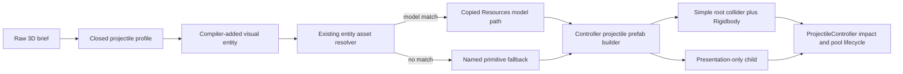

# Projectile Slice 3 — Prefab and Visuals

## Outcome

Slice 3 replaces the undifferentiated runtime sphere with a deterministic
projectile prefab contract. A projectile keeps one compiler-owned physics root
while its presentation is either a model resolved through the existing entity
asset chain or a named primitive fallback. Bullets and thrown rocks remain
visibly distinct through at least two pool reuse cycles.

## Authority boundaries

- The raw brief selects the closed `bullet` or `rock` visual profile in
  `src/unity_projectile_contract.py`; no post-schema LLM call is allowed.
- The projectile visual is represented by a compiler-added entity and resolves
  through `resolve_entity_assets`, the same catalog/copy/`Resources.Load` chain
  used by scene entities.
- A missing projectile-only model is an explicit `primitive:<profile>` result,
  not a guessed asset and not an exception that discards an otherwise valid
  schema.
- Generated C# remains output. Fixes belong in the Python contract, resolver,
  composer, or Jinja templates and must survive regeneration.
- `ProjectileController` remains the sole impact authority. Presentation meshes,
  imported colliders, particles, and trails cannot define collision behavior.

## Compiler flow

## Implementation slices

1. **Typed presentation contract**
   - Version the compiler contract for Slice 3.
   - Add one projectile-visual entity distinct from the held weapon/view model.
   - Carry only closed profile, entity name, fallback name, and target size in
     compiler-owned metadata.

2. **Resolver handoff**
   - Let the visual entity use normal catalog scoring and model copying.
   - Convert only a true miss into `primitive:bullet` or `primitive:rock`, even
     when strict asset mode is enabled.
   - Record the resolved resource in projectile metadata and mark the visual
     entity `skip:projectile-visual` for world spawning.

3. **Prefab construction**
   - Build an inactive, uniformly scaled root with Rigidbody,
     `ContinuousSpeculative`, and a profile-sized SphereCollider.
   - Instantiate the resolved model as a presentation-only child when present.
   - Disable imported colliders/Rigidbodies and bounds-fit the visual without
     changing the physics root.
   - Otherwise create named deterministic fallbacks: a gold capsule/trail for a
     bullet and a brown-grey irregularly scaled sphere for a rock.

4. **Pool reset contract**
   - Snapshot child local transforms and renderer shared materials.
   - On return, restore root and child transforms, materials, velocities,
     collision state, trails, and particles.
   - On launch, clear/re-enable trails and restart projectile presentation
     particles.

5. **Acceptance and regression**
   - Python: profile/entity metadata, strict resolver fallback, resolved-model
     handoff, generated C# structure, and byte-stable regeneration.
   - C# syntax gate: bullet and rock output.
   - Unity: zero compile errors plus advancing Play Mode checks proving distinct
     active renderers, presentation-only child physics, and clean state after
     two borrow/return cycles for both profiles.
   - Preserve all Slice 0–2 gates: owner filtering, swept nearest-hit selection,
     damage once, and pool return.

## Exit gate

Slice 3 is complete only when the same compiler sources regenerate the accepted
Unity scripts; bullet and rock fallbacks are visibly and structurally distinct;
resolved models use the established resource chain; physics stays on the simple
root collider; two reuse cycles restore every declared presentation state; and
the focused suite, scoped CI Ruff, mypy, frozen-Step-3.5 contract, Unity
compile, and Play Mode acceptance all pass. The full suite must either pass or
have every failure reproduced as an unrelated pre-existing environment or
artifact-corpus condition.

## Explicit non-goals

- Muzzle flash/recoil/animation-event firing (Slice 4).
- Held-rock wind-up, hand socket, release event, and tumble (Slice 5).
- New public schema fields or new atom types.
- Hand edits to generated Unity projects.
