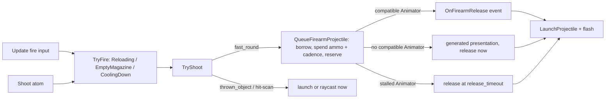

# Projectile Slice 4 acceptance: firearm adapter on the firing provider

Slice 4 adds a deterministic firearm presentation adapter on top of the Slice 3
prefab and visual contract (#267). It was first built on
`codex/projectile-slice4-firearm-adapter` (`293ee12`), against an earlier Slice 3
that #267 superseded. This port moves it onto the R3 firing provider
(`IFiringProvider.TryFire`, `docs/ATOM_BACKEND_SUPPORT.md` "Shared firing
provider"). `ProjectileController` remains the only authority for movement,
swept impact, damage, owner filtering, and pool return.

## Who decides what



`TryFire()` alone decides whether a shot is accepted, for the fire input and the
`Shoot` atom alike. The adapter decides only how an accepted shot is presented
and when its reserved round launches. A borrowed round is the acceptance point
past the gate. If none can be borrowed, the shot is `NoProjectile` and spends
nothing. Otherwise ammunition and cadence are spent exactly once, before either
presentation path can release the round.

## Compiler contract

- `fast_round` carries compiler-owned `firearm_presentation` metadata in
  `src/intent/projectile.py`, and the contract version is `slice4-3d-v4`.
  `thrown_object` never receives the adapter.
- `subsystems_for` hands the block to the controller as
  `meta.firearm_presentation`, as it does `projectile_presentation`.
- `validate_physical_projectile_contract` reports a drifted block. It flags a
  missing adapter on a fast round, an adapter on a thrown object, a release
  event that is not a C# method name, empty or invalid trigger names, and a
  non-positive timeout or recoil distance.
- The one supported release event is `OnFirearmRelease`. Animator trigger
  resolution uses the fixed priority `Fire`, `Attack`, then `Shoot`, and
  accepts trigger parameters only.
- An Animator is compatible only when it is on the controller GameObject, has
  one supported trigger, and one of its clips declares the exact release event.

Not ported from the branch: its `unity-validate` refresh, which re-derived the
contract from the saved brief on replay. On main that would make Step 6
reinterpret prompt text (forbidden by CLAUDE.md), and replay already reproduces
the saved contract and composed selection. A schema saved before this change
replays without the adapter; a fresh run gets it.

## Runtime contract

The generated fallback provides:

- a deterministic muzzle socket search (`Muzzle`, `ProjectileMuzzle`,
  `MuzzleFlash`, `BarrelEnd`; the spawner's `Eye/ProjectileMuzzle` marker is
  found this way), then `GeneratedProjectileMuzzle`;
- a visible generated firearm primitive when no view model is present;
- visual-only recoil on the view model;
- a generated orange muzzle-flash particle system.

Two fixes ride along:

- `ProjectileController` no longer sets velocity on a kinematic body.
  `Configure` leaves kinematic first, and `PrepareForCheckout` / `ResetForPool`
  zero velocity only on a dynamic body. Main logged six "Setting linear/angular
  velocity of a kinematic body is not supported" warnings per acceptance run;
  this run logged none.
- The Animator compatibility cache compares the `RuntimeAnimatorController`
  reference instead of `GetInstanceID()` (repo rule: no `GetInstanceID`).

## Acceptance

```powershell
pwsh -File tools/run_firing_provider_acceptance.ps1
```

The runner creates a clean Unity 6000.1.4f1 project, emits `FirearmShooter`
from a fresh rifle brief's contract through production `subsystems_for` and
`MicroComposer` (the one declared accommodation is `input_backend: legacy`,
because the project carries no Input System package), compiles, and runs the
R3 and Slice 4 Play Mode tests together. Required Slice 4 proof markers:

| Marker | Proves |
| --- | --- |
| `FIREARM_FALLBACK_PASS` | six accepted shots with no Animator: six launches, six ammunition decrements, the same `CoolingDown` cadence as before, six impacts at 25 damage; generated muzzle, flash and presentation exist |
| `FIREARM_ANIM_EVENT_PASS` | a compatible Animator (`Attack` trigger, `OnFirearmRelease` at 0.04 s) holds the reserved round until the event, ahead of the 0.12 s fallback; one launch, one impact, and a duplicate event is a no-op |
| `FIREARM_INCOMPATIBLE_PASS` | a trigger with no release event falls back at once without losing the round |

The Python side is `tests/test_projectile_firearm_adapter.py`, including a
Roslyn compile of the adapter controller against the real Unity reference
assemblies.
