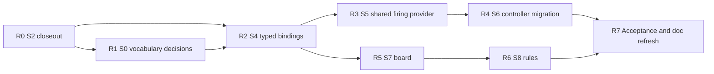

# Repository drift remediation

Status reviewed: 2026-11-07

This table tracks implemented roadmap mechanisms. It does not mean every broad
roadmap exit criterion is universally proven. In particular, authority is
documented by domain rather than for every concrete module, and intent-ledger
diffs do not yet provide a per-write origin for every deterministic schema
mutation. See `docs/PHASE3_SCHEMA_AUTHORITY.md`.

| Roadmap phase | Implemented evidence |
| --- | --- |
| 0 Stabilization | protected-main policy, generated-C# workflow, real Unity workflow, RFC-0001 |
| 1 Observability | append-only intent ledger, six pipeline snapshots, prompt truncation warning/report |
| 2 Intent authority | claim producers, one resolver, explicit exclusion claims |
| 3 Schema-mutating sidecars | projectile intent moved to claims; schema materialization isolated; asset binding detached; direct and staged validators guarded |
| 4 Decomposition | seven named stage classes and single-execution registry; one resolver and reconciliation pass |
| 5 Consolidation | Compose Micros default, `PrimitiveProvider`, `AssetBinder` |
| 6 Mechanic registry | Fire, Projectile, and Health pilot registrations |
| 7 Evaluation | 30 prompt goldens in three cohorts and dated `eval_runs` history |
| 8 Hygiene | shared policy generator, restored installer, archived obsolete verification scripts |
| 9 Authority architecture | RFC enforcement in code, tests, CI, and execution provenance |

## Mechanics realignment status

Slices S0-S8 are defined in `docs/ATOM_BACKEND_SUPPORT.md` (migration queue).
Reviewed on main `1d75000`.

| Slice | State | Evidence |
| --- | --- | --- |
| S0 atom/backend support audit | Done | #283; `support_audit --check` passes (Unity 65 executable / 25 descriptive / 6 internal) |
| S0 vocabulary/alias review | Done (R1) | All 16 `S0-followup-*` entries closed; one owner per token, dialog/escort helpers registered, six capability placeholders retired (Unity 71 executable / 25 descriptive / 0 internal) |
| S1 Roslyn API extraction | Done | #284, #285 |
| S2 consumer cutover | Done; R0 closeout complete | `c239ac8`; R0 removed the surviving tables, binder and erasers (see R0) |
| S3 ownership closure | Done | #289; 3 `connected_and_owned`, 2 `connected_but_not_attached`, 1 `missing_provider` |
| Phase 3 schema authority | Done | #290 |
| Untouched-brief preflight | Done | #291 |
| S4 typed bindings | Done (R2) | `meta.atom_bindings` v1 (`src/atom_bindings.py`); ownership audit: 4 `connected_and_owned`, 1 `retired`, 1 `missing_provider`, 0 `connected_but_not_attached` |
| S5-S8 | Not started | 24 baseline entries name S6, 1 names S5 |

## Remaining plan

| Step | Slice | Scope | Exit criterion |
| --- | --- | --- | --- |
| R0 | S2 closeout | Remove the copied project API tables and every uncalled consumer built on them. Move the Step 3.5 correction checks (`_would_not_bind`, `_script_would_not_bind`) off the mutating template binder onto the extracted contract. Derive HUD setter availability (`hud_setters` / `_VARIANT_SETTERS`) from selected writer output. Replace the live generator collaborator erasers (invented namespace/stub/constructor/find filters, undeclared self-call/condition/foreach filters) with preserved source plus structured diagnostics. Decide `_MB_METHOD_ARITY` / `_MONO_INHERITED`: real Unity references or an explicit framework-only allowlist. | No copied project API table remains; S2 regression matrix and real Editor compile gate pass. |
| R1 | S0 vocabulary review | Decide the four identity collisions (pause/Pause, roll_evade, thrust, kick); register or retire the six dispatch-only dialog helpers and six unregistered capability names. | Every `S0-followup-*` baseline entry closed or carries a recorded decision. |
| R2 | S4 | Persist typed host/phase/trigger/provider bindings in schema meta with versioned replay. Attach or retire the two unattached routes (`GameSequencer`, `ControllerDefaultBehavior` companion). Validate dynamic atom references per build. | Ownership audit reports zero `connected_but_not_attached`; saved-schema replay reproduces bindings twice. |
| R3 | S5 | Unity `Shoot` lowerer through one firing provider shared by input and atom; ammo, cooldown and failure behavior proven. Rebase or retire `codex/projectile-slice4-firearm-adapter` here. | Zero `missing_provider`; Shoot leaves the baseline; advancing Editor runtime test. |
| R4 | S6 | Migrate the 24 baselined controller atoms one behavior per PR with per-variant advancing tests. Controller leaves `protected_template_owners` only when every variant is covered. | All S6 baseline entries closed. |
| R5 | S7 | Legal board operations (`TryPlace`, command parser) behind one atom-founded owner. | Board leaves `protected_template_owners`; SEAM 8a binds to the new owner. |
| R6 | S8 | Rules progression (`steps_from_missions`) behind the same single owner. | Rules leaves `protected_template_owners`. |
| R7 | Acceptance | Universal per-write schema mutation journal, or an explicitly documented scope limit; refresh this file and `ATOM_BACKEND_SUPPORT.md`; 20-30 case untouched-brief evaluation from a clean `unity-create-run-log/v2` run. | Exact clean-commit lineage plus Editor compile evidence. |

Every step branches from current `origin/main` and must pass ruff, mypy, full
pytest, `support_audit --check`, `ownership_audit --check`, generated C# and the
real Unity Editor compile gate. Runtime acceptance stays **unverified** until an
advancing Editor test exists for that slice.

Open decisions:

- `codex/recover-mechanics-playtest` (9 commits, September) applies
  deterministic schema and atom patches outside the resolver. Port it as
  resolver claims under the Phase 3 authority model, or archive it.
- ~~Framework member tables in R0~~ — decided: real Unity reference
  assemblies (`component_api.unity_editor`), both tables deleted. See R0.
- ~~R1 collision policy~~ — decided: one owner per token, enforced at import
  by `src/atoms/__init__._build_alias_index`. See `ATOM_BACKEND_SUPPORT.md`,
  "R1 vocabulary decisions".

### R0 progress

First pass (branch `codex/r0-s2-closeout`):

- Removed `_COMPOSED_CLASS_API`, `_COMPOSED_METHOD_ARITY`,
  `_COMPOSED_CLASS_EVENTS`, `_ANIMATOR_DYNAMIC_MEMBER_RE` and the uncalled
  consumers built on them (`_make_composed_call_stripper`,
  `_sanitize_composed_component_calls`, `_sanitize_project_service_calls`,
  `_sanitize_field_typed_member_calls`, `_sanitize_param_typed_member_calls`,
  `_custom_script_api`, `sanitize_subsystem_composed_calls`). None had a
  production caller after `c239ac8`; only tests exercised them.
- Removed the other consumers S2 left uncalled: `_drop_unresolvable_types`,
  `_bind_script`, `sanitize_subsystem_invented_constructors`,
  `sanitize_subsystem_builtin_call_arity`, and the ignored `known_types`
  parameter of `unity_micro_code._apply` with its helper chain.
- Removed a duplicate `_PARAM_MODIFIERS` binding that silently shadowed the
  fuller set used by `_signature_type_names`; `readonly`/`scoped` parameter
  modifiers are now stripped as that function's own definition intended.
- Removed the custom-script repair helpers only `_bind_script` called
  (`lint_underscore_alias_references`, `required_usings_for`,
  `jagged_rank_corrections`, `correct_qualified_type`). Custom scripts get no
  missing-using insertion, jagged-rank fix or qualified-type correction; the
  Roslyn contract and Editor gate report those defects instead.
- `_script_would_not_bind` no longer hides a bare name whose underscored twin
  is declared. It assumed a rebinding pass that was unreachable, so the
  author was never told and the script shipped CS0103.
- Isolated the four token-less Sketchfab client tests from a developer
  `SKETCHFAB_API_TOKEN` (two had been passing only via a live network call).

Second pass (same branch) — the four remaining items:

| Item | Change |
| --- | --- |
| Framework table decision | Real Unity references. `src/unity_reference_profile.py` resolves `component_api.unity_editor` (+ optional `package_assemblies`) to the Editor's `UnityEngine*.dll` and .NET Standard 2.1; absence abstains loudly with a remedy. `_MB_METHOD_ARITY`, `_MONO_INHERITED`, `_KNOWN_SYMBOLS` deleted; the frozen `unity_api_surface` (+ `unity-api-surface` command, `lookups/unity/api_surface.json`) lost its only consumer and was removed. |
| Correction-check migration | `src/unity_authored_check.py`: a proposal is rendered by its production writer, overlaid on the selected baseline and compiled by the pinned Roslyn against the reference profile; only errors it INTRODUCES go back to the model, in compiler wording. `_would_not_bind` / `_script_would_not_bind` deleted. Package namespaces outside the profile are reported as unverified, not as corrections. No profile → no correction round, recorded. |
| Binder retirement | `bind_authored_code` and its helper chain (≈1,150 lines) removed from `harden_against_template`, which now only drops duplicate template members (CS0102/CS0111) and heals usings. The `engine` parameter it gated went with it. |
| Live collaborator erasers | Invented namespace/stub-usage/constructor/find filters, wrong-arity GetComponent strip, undeclared self-call/condition/foreach filters deleted. `normalize_custom_script` keeps only engine-fixed structural normalizers. Defects are recorded with source intact in `meta.component_api_final.script_source_check`. |
| Checker/Step 6 parity (review of #292) | The custom-script check had rebuilt Step 6's script rendering by hand and diverged five ways: lint only, a generator per script (duplicate stubs, CS0101), a known-type set missing micro template types, payload lists replacing Step 3's instead of appending, and no non-custom scripts or GameContext companions (false CS0103 on `GameManager`, CS0246 on `StatModifier`). It now calls Step 6's own `prepare_scripts`, `stub_known_types`, `script_render_context` and `render_project_scripts` on a deep copy after Step 5's `inject_boilerplate_scripts` and `drop_owned_scripts`, and lands a proposal with `_apply_script`. The final record counts only the shipped custom scripts' own diagnostics. A parity test pins the checker's Assets/Scripts render byte-identical to `generate()`. |
| HUD setter derivation | `MicroComposer.bind_component_contract` + `plan()` read HUD setters from the selected Roslyn contract (public methods of the rendered class). No contract → HUD seams abstain loudly. `_VARIANT_SETTERS` / `hud_setters` deleted; widget collision reads the variant-scoped template. Pipeline and replay bind the final contract before `plan()`. |

`micro_stress` now asserts preservation: a finding is an authored poison line
that did NOT reach the emitted source (it had reported every kind as FAIL since
S2, inverted).

Remaining, recorded rather than silently kept:

- `_reject_unbalanced_custom_bodies` (empties an unparseable body) and the
  invented-field-type stub emitter stay: both are structural, not collaborator
  judgements. The S2 table lists them; retiring them needs the syntax gate to
  carry the rejection instead.
- `_auto_declare_undeclared_scalars` still consults `_MB_COMMON_MEMBERS` /
  `_STATIC_CLASS_ALLOW` so it never declares `transform` as a float. It adds
  fields rather than erasing; moving it onto Roslyn CS0103 sites is R2 work.
- `_VARIANT_FIELDS` (HUD field collision) is still a per-variant table.

Exit criterion status: no copied project API table remains; framework
semantics come from real assemblies. ruff, mypy, full pytest and both audits
pass locally. The real Unity Editor compile gate (`pytest -m unity_compile`,
`unity-validation.yml`) must still be run on this branch before merge.

### R2 progress

Exit criterion met: the ownership audit reports zero
`connected_but_not_attached`, and a saved schema replayed twice reproduces its
atom bindings (`tests/test_atom_bindings.py`).

| Item | Change |
| --- | --- |
| Typed bindings | `src/atom_bindings.py` derives host class, host, phase, trigger, scenes and per-atom provider for `atoms`, `entities[*].atoms` and `scripts[*].atoms`, and persists `meta.atom_bindings` (`version: 1`). `generate()` derives the record, then places hosts from it. |
| Versioned replay | A matching saved record is confirmed; drift is named route by route; an unreadable version is announced. The record is re-stamped from the canonical schema each time, never trusted silently. Pipeline, `unity-validate` and `unity_eval.replay` print the report. |
| GameSequencer | Attached: each gameplay scene hosts a scene-local `_GameSequencer` (not `GameManager`, whose `DontDestroyOnLoad` duplicate-destroy would kill it). No host scene means no sequencer is emitted. |
| ControllerDefaultBehavior | Retired with every Unity companion. The audit proves the hook is call-free for each Unity micro; re-emitting fails as `connected_but_not_attached`, which validation now rejects. |
| Dynamic references | Each schema atom name is checked per build: `lowered`, `alias`, `descriptive`, `unsupported` or `unregistered`. Non-lowered names are warned as `// TODO` emitters, never rewritten. |
| Entity behavior | Atom-driven entities get `behavior = <Name>Behavior`, the only class their atoms render into; a blank or foreign name had left them unattached. |

Scope limit: compiler-selected wiring atoms stay in `GameWiring`; no gameplay
changes phase. Runtime acceptance stays **unverified**.

## Trace answer

For intent-controlled decisions in a generated schema, inspect
`meta.intent_ledger`:

1. `claims` names the value, source, confidence, and rationale.
2. `meta.intent_resolution.winners` names the canonical winner per field.
3. `snapshots` and `diffs` show when the schema changed.
4. `meta.mechanic_registry` maps enabled mechanics to runtime, generator,
   templates, and validators.
5. `meta.execution_report.warnings` exposes any prompt truncation.

This is the deterministic answer for resolver-owned intent. Other deterministic
compiler writes still require their stage-specific provenance until a universal
schema mutation journal exists.

Ledger checkpoints capture nested state by value. Registered claims, returned
resolutions and applied schema metadata have separate ownership, so later
asset binding can update the working schema without rewriting the evidence or
prior checkpoints. Ledger reports and diffs are detached exports; editing them
does not change recorded history. The persisted formats remain
`intent-ledger/v1` and `intent-resolution/v1`.
